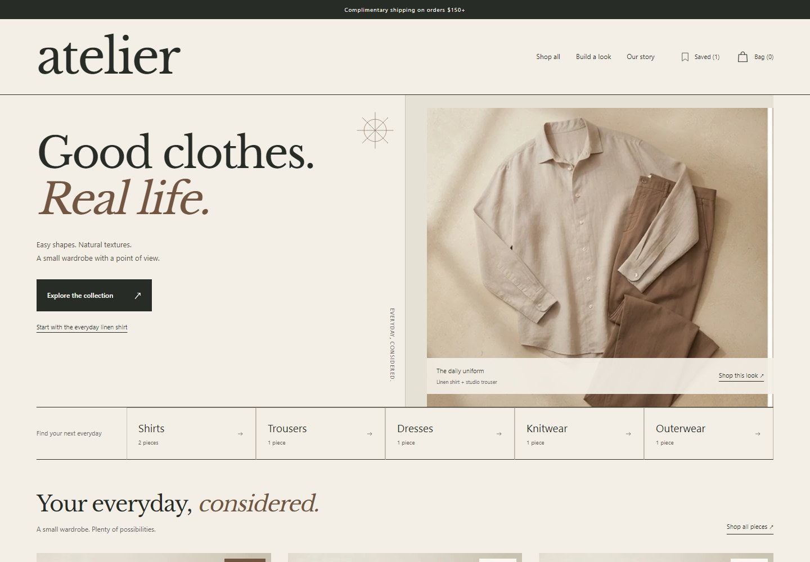

# Atelier

**English** · [Русский](README.ru.md)

[](https://github.com/alexsashka1771/commerce-atelier/actions) · [MIT](LICENSE) · [Requirements audit](docs/requirements-audit.md)

A clothing store with an editorial desktop storefront and a working operations admin. Products, variants, galleries, stock and orders are backed by SQLite; checkout recalculates prices on the server and reserves stock transactionally.

**Stack:** Next.js 16 · React 19 · TypeScript · SQLite · Stripe test adapter



## Features

- Catalog search, category filters, price sorting, product galleries and size/color availability.
- Persistent cart, quantity/removal controls, saved pieces and atomic additions of complete outfits.
- Name/phone/address checkout, cash on delivery, order receipts and an optional Stripe test adapter.
- Authenticated product/category CRUD, multiple image uploads, per-variant stock, order statuses and contact inbox.
- Integer-cent prices, immutable order snapshots, idempotent checkout/webhooks and stale-stock-edit protection.

## Quickstart

**Requirements:** Node.js 24 and npm.

```powershell
git clone https://github.com/alexsashka1771/commerce-atelier.git
Set-Location commerce-atelier
npm ci
npm run setup
npm run dev -- --hostname 127.0.0.1 --port 3102
```

Open [http://127.0.0.1:3102](http://127.0.0.1:3102).

Setup creates an ignored .env.local and prints a random admin password once. Save it; the default login is admin@atelier.local. Run setup only once. All commands below run from the cloned repository root.

## Try the workflow

1. Browse a product, choose size/color and add it to the bag.
2. Change quantity, refresh, then complete cash-on-delivery checkout.
3. Open /admin with the credentials from setup; edit a product and a variant stock count.
4. Inspect the order, update its status and review a contact-form inquiry.

## Code to inspect

- [Catalog, stock and order transactions](src/lib/store.ts)
- [Payment retry and reconciliation boundaries](src/lib/stripe-checkout.ts)
- [Bounded image uploads](src/lib/uploads.ts)
- [Checkout, inventory and payment regressions](tests)

## Verification

```powershell
npm test
npm run typecheck
npm run build
npm run test:http
```

Original-brief coverage, fresh results and evidence boundaries: [requirements audit](docs/requirements-audit.md) · [terminal output](docs/publication-test-output.txt).

## Integration status

Cash-on-delivery is verified locally. Stripe session creation and signed, idempotent webhooks are implemented; actual Stripe network payment is not part of the published verification. Set STRIPE_SECRET_KEY and STRIPE_WEBHOOK_SECRET through the environment for test mode. Live Stripe keys are rejected. Shipping, tax, refunds, reservation reconciliation and public-deployment operations need separate integration work. Garment photos are synthetic demo assets.

Secrets are supplied through the environment. Local databases, keys and environment files are excluded from Git.

---

More projects: [alexsashka1771](https://github.com/alexsashka1771)
