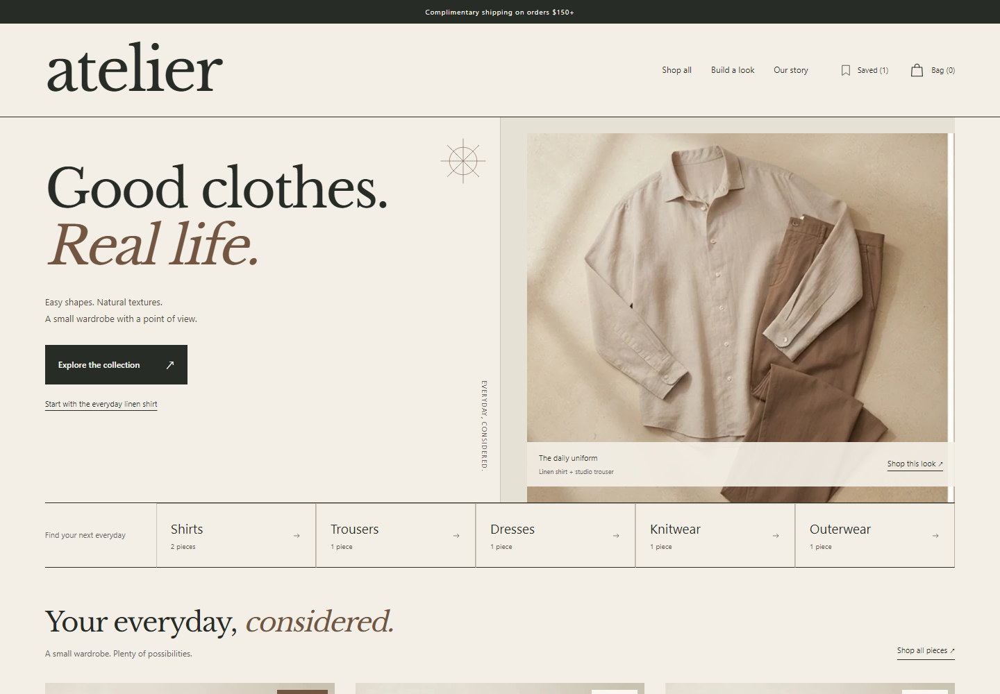

# Atelier

[English](README.md) · **Русский**

[](https://github.com/alexsashka1771/commerce-atelier/actions) · [MIT](LICENSE) · [Проверка ТЗ](docs/requirements-audit.md)

Магазин одежды с журнальным десктопным интерфейсом и рабочей админ-панелью. Товары, варианты, галереи, остатки и заказы хранятся в SQLite. Оформление заказа пересчитывает цены на сервере и резервирует остатки в транзакции.

**Стек:** Next.js 16 · React 19 · TypeScript · SQLite · Stripe test adapter



## Возможности

- Поиск по каталогу, фильтры категорий, сортировка цен, галереи и доступность размеров/цветов.
- Сохраняемая корзина, изменение количества и удаление, избранное и атомарное добавление целого образа.
- Оформление с именем, телефоном и адресом, оплата при получении, квитанции и опциональный Stripe test-адаптер.
- Защищённое управление товарами/категориями, загрузка нескольких фото, остатки вариантов, статусы заказов и обращения.
- Цены в целых центах, неизменяемые снимки заказов, идемпотентность оформления/webhook и защита от устаревших правок остатков.

## Запуск

**Требования:** Node.js 24 и npm.

```powershell
git clone https://github.com/alexsashka1771/commerce-atelier.git
Set-Location commerce-atelier
npm ci
npm run setup
npm run dev -- --hostname 127.0.0.1 --port 3102
```

Откройте [http://127.0.0.1:3102](http://127.0.0.1:3102).

Setup создаёт исключённый из Git файл .env.local и один раз выводит случайный пароль администратора. Сохраните его; логин по умолчанию — admin@atelier.local. Setup запускается один раз. Все команды выполняются из корня репозитория.

## Сценарий демонстрации

1. Откройте товар, выберите размер/цвет и добавьте его в корзину.
2. Измените количество, обновите страницу и оформите заказ с оплатой при получении.
3. Войдите в /admin с данными setup и измените товар и остаток варианта.
4. Изучите заказ, смените статус и проверьте обращение из контактной формы.

## Что посмотреть в коде

- [Транзакции каталога, остатков и заказов](src/lib/store.ts)
- [Повторы платежа и границы сверки](src/lib/stripe-checkout.ts)
- [Ограниченная загрузка изображений](src/lib/uploads.ts)
- [Проверки заказа, остатков и платежей](tests)

## Проверка

```powershell
npm test
npm run typecheck
npm run build
npm run test:http
```

Матрица исходного ТЗ, свежие результаты и границы проверок: [аудит требований](docs/requirements-audit.md) · [вывод терминала](docs/publication-test-output.txt).

## Статус интеграций

Оплата при получении проверена локально. Создание Stripe-сессии и подписанные идемпотентные webhook реализованы, но реальный сетевой платёж Stripe в опубликованную проверку не входит. Для тестового режима задайте STRIPE_SECRET_KEY и STRIPE_WEBHOOK_SECRET через окружение; live-ключи отклоняются. Доставка, налоги, возвраты, сверка резервов и эксплуатация публичного магазина требуют отдельных интеграций. Фото одежды — синтетические демо-материалы.

Секреты задаются через окружение. Локальные базы, ключи и файлы окружения исключены из Git.

---

Другие проекты: [alexsashka1771](https://github.com/alexsashka1771)
